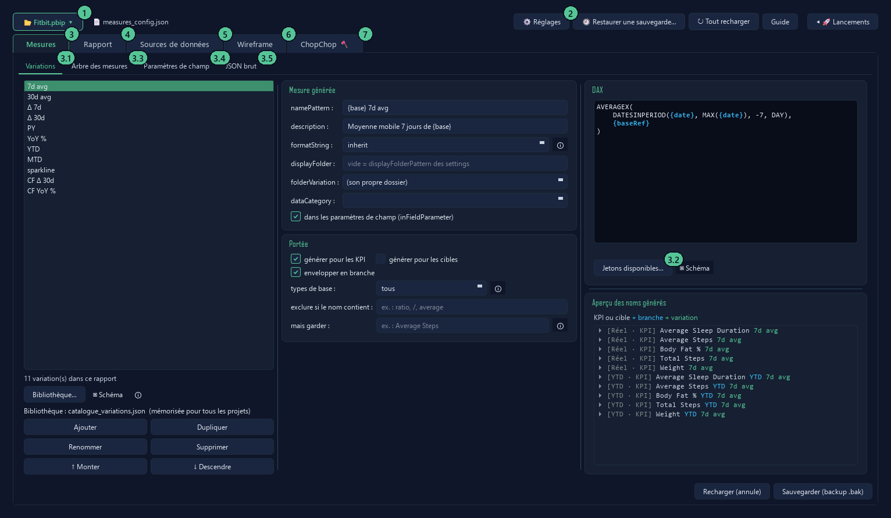

# Documentation de PBIdouille

Le mode d'emploi, élément par élément. Chaque numéro de la capture est celui d'un
article, et les articles se lisent dans cet ordre. Pour commencer, l'article 0 donne
une vue d'ensemble en images.

| N° | Article | Ce qu'on y fait |
|---|---|---|
| 0 | [Aperçu](articles/00-apercu.md) | Ce que fait chaque partie, en images, avant le détail |
| 1 | [La barre du haut](articles/01-barre-du-haut.md) | Changer de rapport, restaurer une sauvegarde, tout recharger |
| 2 | [⚙ Réglages](articles/02-reglages.md) | Génération, Excel des indicateurs, branches, cibles, formats delta |
| 3 | **Mesures** | Les variations et ce qu'elles génèrent |
| 3.1 | [Variations](articles/03-1-variations.md) | Créer une mesure, et ce que chaque réglage change dans Power BI |
| 3.2 | [Les jetons](articles/03-2-jetons.md) | `{base}`, `<<attributs>>` de TD_Indicateurs, et où chacun se règle |
| 3.3 | [Arbre des mesures](articles/03-3-arbre-des-mesures.md) | Tout ce que la génération produira, et le DAX final |
| 3.4 | [Paramètres de champ](articles/03-4-parametres-de-champ.md) | Les tables d'un segment, et ce qu'elles contiendront |
| 3.5 | [JSON brut](articles/03-5-json-brut.md) | Modifier directement `measures_config.json` |
| 4 | [Rapport](articles/04-rapport.md) | Propager le formatage d'un KPI vers les autres, colorer les matrices |
| 5 | [Sources de données](articles/05-sources-de-donnees.md) | D'où vient chaque table, et ce qui manque sur ce poste |
| 6 | [Wireframe](articles/06-wireframe.md) | Organiser les visuels d'une page (édition de développement) |
| 7 | [ChopChop](articles/07-chopchop.md) | Repérer ce que plus rien n'utilise |

## Aussi

- [Le guide de démarrage](PBIdouille%20-%20Guide%20de%20demarrage%20rapide.pptx), en PowerPoint
- [La référence technique](../README.md)
- `ressources/` : les images, les diapos exportées et les scripts qui les fabriquent
