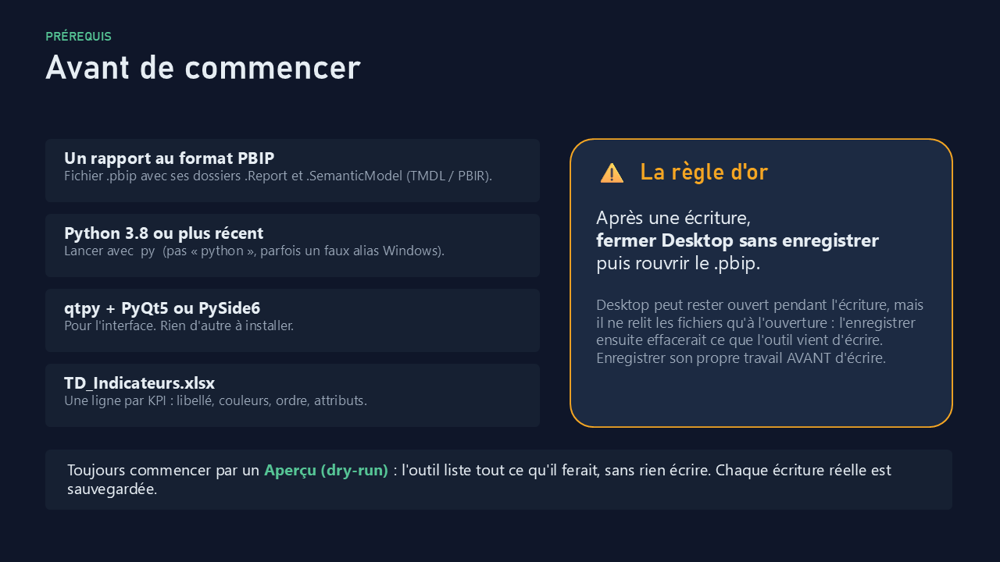
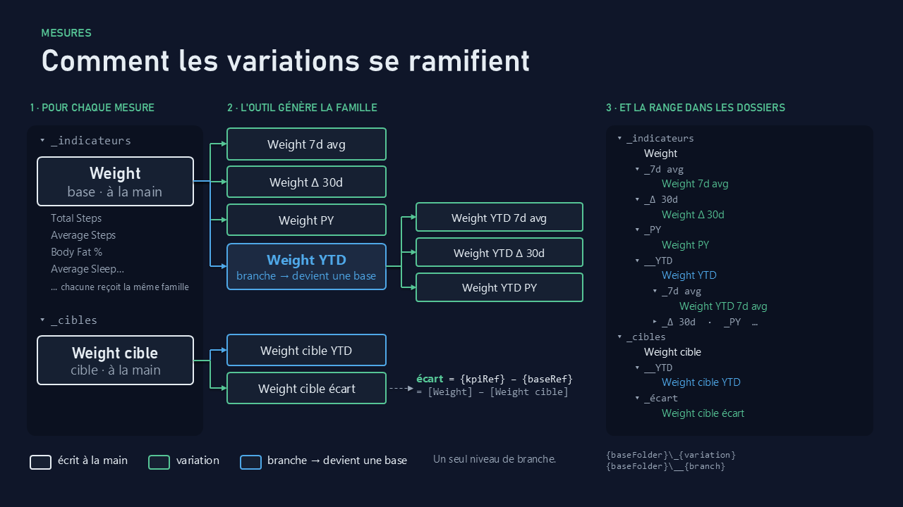
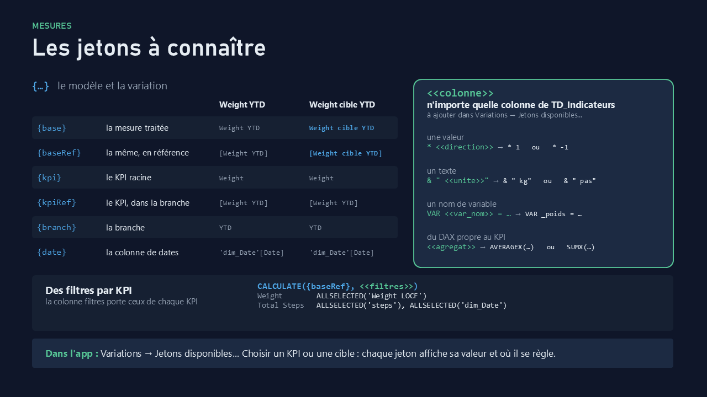
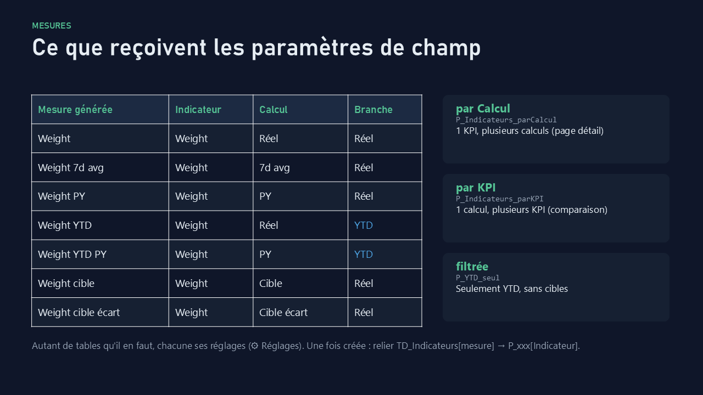
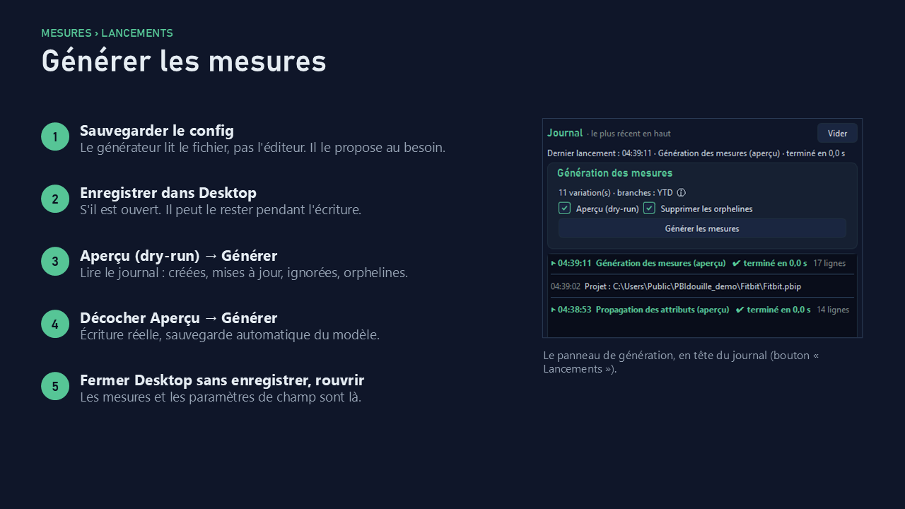
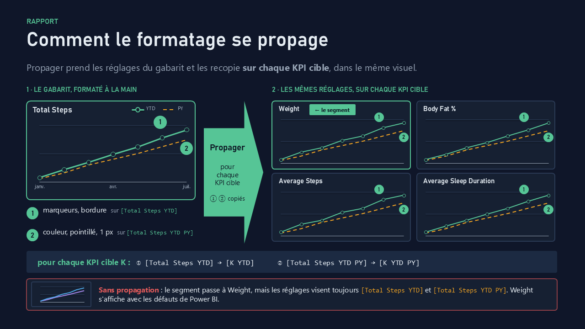
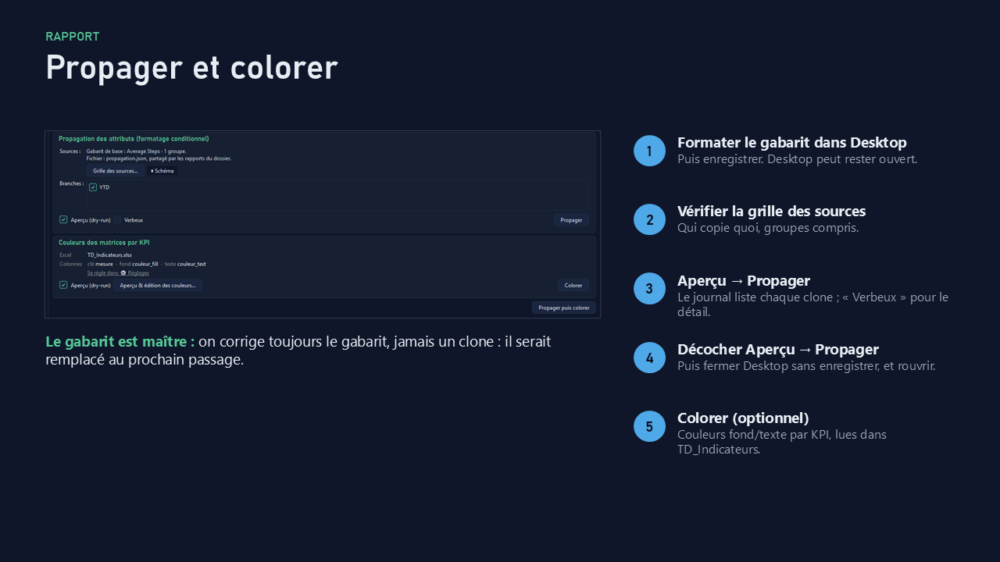
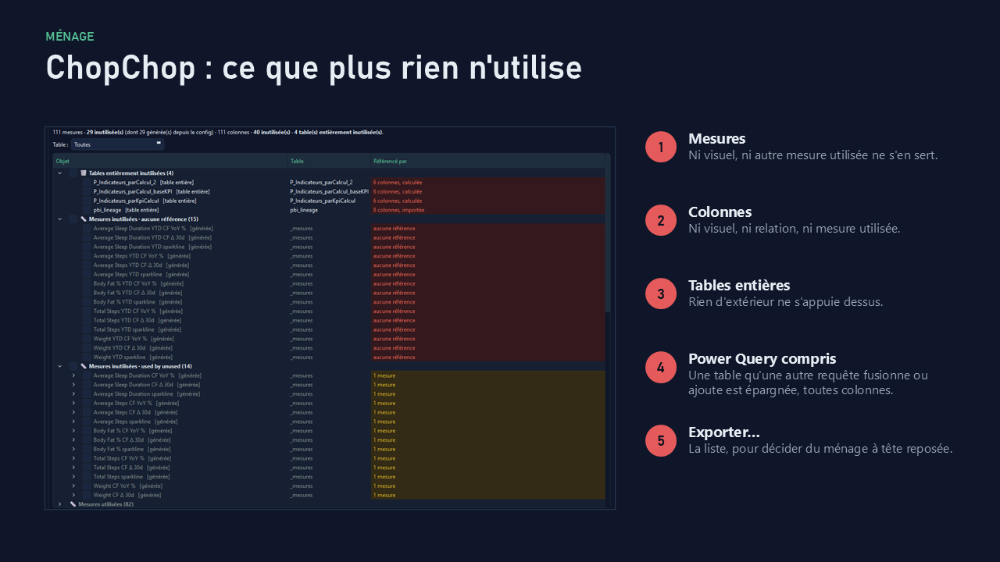

# 0 · Aperçu

[Documentation](../README.md) › **Aperçu** · voir aussi [le guide de démarrage](../PBIdouille%20-%20Guide%20de%20demarrage%20rapide.pptx)

Ce que fait PBIdouille, en quelques images, avant d'entrer dans le détail. Chaque partie
renvoie à l'article qui l'explique en entier.

## En un coup d'œil

PBIdouille écrit ce qui se répète dans un rapport Power BI, directement dans ses fichiers.
Tout se passe dans quatre onglets, qui travaillent sur le même rapport :

| Onglet | Rôle | Article |
|---|---|---|
| **Mesures** | Créer les variations de chaque KPI et les tables paramètre de champ | [3.1 Variations](03-1-variations.md) |
| **Rapport** | Recopier le formatage d'un KPI vers les autres, colorer les matrices | [4 Rapport](04-rapport.md) |
| **Sources de données** | Voir d'où vient chaque table | [5 Sources de données](05-sources-de-donnees.md) |
| **ChopChop** | Repérer ce que plus rien n'utilise | [7 ChopChop](07-chopchop.md) |

## Avant de commencer

Le rapport doit être au format **PBIP**. Power BI Desktop doit être **fermé** pendant chaque
écriture : il ne relit les fichiers qu'à l'ouverture, et écraserait les changements en
enregistrant.

## Ouvrir un rapport

La barre du haut est la même partout : elle choisit le rapport et son config, et donne accès
aux réglages, aux sauvegardes et au journal.

→ [1 La barre du haut](01-barre-du-haut.md) · [2 ⚙ Réglages](02-reglages.md)

## Mesures : les variations

Une **variation** s'écrit une fois, comme `7d avg` ou `PY`, et PBIdouille en génère une
mesure pour chaque KPI. Une **branche**, comme YTD, applique ensuite les autres variations à
l'intérieur d'elle-même.

→ [3.1 Variations](03-1-variations.md) · [3.3 Arbre des mesures](03-3-arbre-des-mesures.md)

## Mesures : les jetons

Les **jetons** sont les parties du DAX qui changent d'un KPI à l'autre : `{baseRef}` devient
`[Weight]`, `<<unite>>` devient la valeur de la colonne `unite` de TD_Indicateurs.

→ [3.2 Les jetons](03-2-jetons.md)

## Mesures : les paramètres de champ

Les tables paramètre de champ permettent de choisir, dans un segment, quelle mesure un visuel
affiche. PBIdouille les remplit avec les KPI, leurs cibles et leurs variations.

→ [3.4 Paramètres de champ](03-4-parametres-de-champ.md)

## Mesures : générer

La génération écrit les mesures et les tables paramètre dans le modèle. L'aperçu, coché par
défaut, montre tout sans rien écrire.

→ [3.1 Variations](03-1-variations.md#7-sauvegarder-puis-générer)

## Rapport : propager le formatage

Le formatage se fait une fois sur un KPI **gabarit** dans Power BI Desktop. La propagation le
recopie sur les mesures équivalentes des autres KPI, visuel par visuel.

→ [4 Rapport](04-rapport.md)

## Sources de données

L'onglet dit d'où vient chaque table du rapport : Excel, CSV, base ODBC ou serveur SQL. Il
signale aussi un fichier local introuvable sur ce poste.

→ [5 Sources de données](05-sources-de-donnees.md)

## ChopChop : le ménage

ChopChop liste les mesures, colonnes et tables que plus rien n'utilise, et exporte la liste.

→ [7 ChopChop](07-chopchop.md)

## Les filets de sécurité

Chaque écriture est précédée d'une sauvegarde, et le journal raconte tout ce que l'outil fait.

→ [Restaurer une sauvegarde](01-barre-du-haut.md#restaurer-une-sauvegarde)

## En cas de pépin

---

[Sommaire](../README.md) · [1 La barre du haut](01-barre-du-haut.md) →
