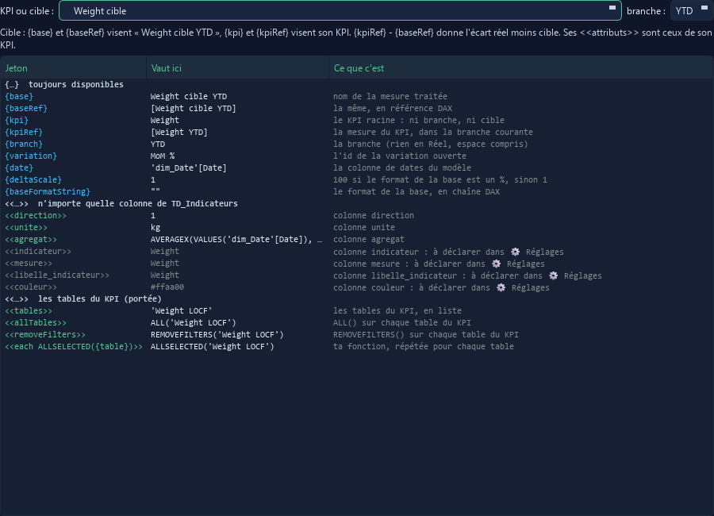
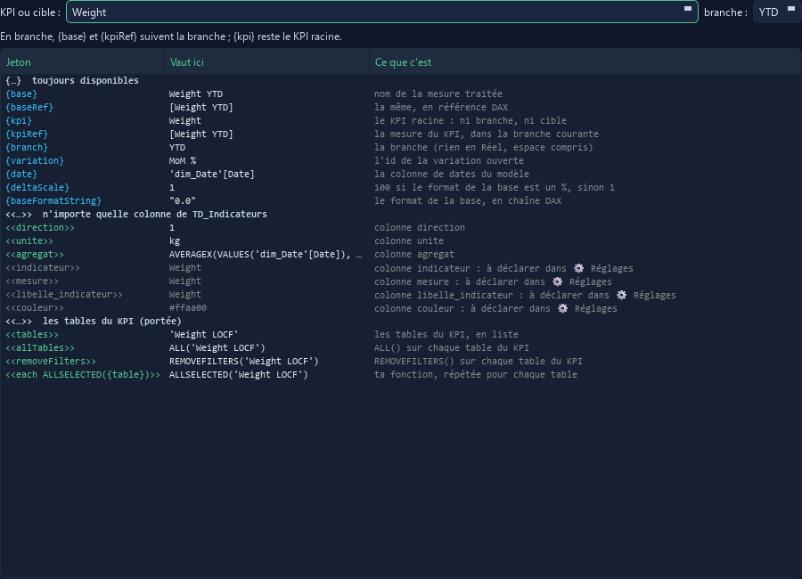

# Mesures › Les jetons

[Documentation](../README.md) › Mesures › **Jetons** · voir aussi [Variations](variations.md)

Une variation s'écrit une seule fois. Les **jetons** sont les parties qui changent
d'un KPI à l'autre : la génération les remplace pour chaque KPI, cible et branche.

| Dans l'éditeur | Jeton | D'où vient la valeur |
|---|---|---|
| bleu | `{base}`, `{date}`… | du modèle et de la variation |
| vert | `<<unite>>`, `<<each …>>`… | de **TD_Indicateurs** |
| rouge souligné | un jeton inconnu | une faute de frappe, ou un attribut pas encore déclaré |

## Voir ce que vaut un jeton

Dans **Mesures › Variations**, ouvre **Jetons disponibles** sous le DAX. Choisis un
KPI **ou une cible**, puis une branche : chaque jeton affiche sa valeur. Un
double-clic insère le jeton dans le DAX.

Ces valeurs viennent de la génération elle-même : c'est ce qui sera écrit.



Le même écran sur le KPI `Weight` en YTD : `{base}` et `{baseRef}` changent, `{kpi}`
et `{kpiRef}` non.



## Les jetons `{…}`

| Jeton | Ce que c'est | `Weight` | `Weight YTD` | `Weight cible` | `Weight cible YTD` |
|---|---|---|---|---|---|
| `{base}` | la mesure traitée | `Weight` | `Weight YTD` | `Weight cible` | `Weight cible YTD` |
| `{baseRef}` | la même, en référence DAX | `[Weight]` | `[Weight YTD]` | `[Weight cible]` | `[Weight cible YTD]` |
| `{kpi}` | le KPI racine | `Weight` | `Weight` | `Weight` | `Weight` |
| `{kpiRef}` | le KPI, dans la branche | `[Weight]` | `[Weight YTD]` | `[Weight]` | `[Weight YTD]` |
| `{branch}` | la branche | *(rien)* | `YTD` | *(rien)* | `YTD` |

Ceux-ci ne dépendent pas de la branche :

| Jeton | Ce que c'est | Exemple |
|---|---|---|
| `{variation}` | l'identifiant de la variation | `MoM %` |
| `{date}` | la colonne de dates du modèle | `'dim_Date'[Date]` |
| `{deltaScale}` | `100` si le format de la base est un %, sinon `1` | `1` |
| `{baseFormatString}` | le format de la base, en texte DAX | `"0.0"` |

Ils fonctionnent dans le **nom**, la **description** et le **DAX**.

### KPI et cibles

Une cible est une mesure de base à part entière : `{base}` et `{baseRef}` la
désignent, alors que `{kpi}` et `{kpiRef}` désignent son KPI. C'est ce qui permet
de les comparer :

```dax
{kpiRef} - {baseRef}
```

```dax
Weight cible écart = [Weight] - [Weight cible]
```

Coche **générer pour les cibles** et décoche **générer pour les KPI** : sur un KPI,
`{kpiRef}` et `{baseRef}` sont la même mesure et l'écart vaudrait 0.

### `{branch}` dans un nom de mesure

Hors branche, `{branch}` disparaît **avec l'espace qui le touche**, ce qui permet
de viser n'importe quelle mesure de la même branche :

| Écrit | En Réel | En YTD |
|---|---|---|
| `[{kpi} cible {branch}]` | `[Weight cible]` | `[Weight cible YTD]` |
| `[{kpi} {branch} PY]` | `[Weight PY]` | `[Weight YTD PY]` |

Une variation dont le DAX cite `{branch}` est écrite pour la branche : elle est
toujours recopiée, jamais enveloppée.

## Les jetons `<<…>>` : n'importe quelle colonne de TD_Indicateurs

Chaque colonne de `TD_Indicateurs.xlsx` peut devenir un jeton. Sa valeur est celle
de la ligne du KPI, et elle est **écrite telle quelle** à la place du jeton.

Pour en déclarer un : **⚙ Réglages → Excel des indicateurs → Attributs codés en
dur**, un nom de jeton et sa colonne. Dans **Jetons disponibles**, les colonnes pas
encore déclarées apparaissent en gris, avec ce qu'elles vaudraient.

Exemple de `TD_Indicateurs` :

| mesure | direction | unite | var_nom | agregat |
|---|---|---|---|---|
| Weight | 1 | kg | `_poids` | `AVERAGEX(VALUES({date}), {baseRef})` |
| Total Steps | 1 | pas | `_pas` | `SUMX(VALUES({date}), {baseRef})` |

### Une valeur

```dax
{baseRef} * <<direction>>
```

### Du texte

La valeur arrive sans guillemets : mets-les dans le DAX.

```dax
FORMAT({baseRef}, {baseFormatString}) & " <<unite>>"
```

```dax
Weight libellé = FORMAT([Weight], "0.0") & " kg"
Total Steps libellé = FORMAT([Total Steps], "#,0") & " pas"
```

### Un nom de variable, ou un morceau de nom

```dax
VAR <<var_nom>> = {baseRef}
RETURN <<var_nom>> * 2
```

Le jeton marche aussi dans le **nom** de la mesure (`{base} en <<unite>>` donne
`Weight en kg`) et dans sa **description**.

### Du DAX différent pour chaque KPI

Une cellule peut contenir du code, **jetons compris**. La variation reste unique,
et chaque KPI apporte sa logique :

```dax
VAR valeur = <<agregat>>
RETURN valeur * <<direction>>
```

```dax
Weight tendance =
    VAR valeur = AVERAGEX(VALUES('dim_Date'[Date]), [Weight])
    RETURN valeur * 1

Total Steps tendance =
    VAR valeur = SUMX(VALUES('dim_Date'[Date]), [Total Steps])
    RETURN valeur * 1
```

### Les règles

- **Cellule vide : pas de mesure** pour ce KPI, et le journal dit laquelle et
  pourquoi. Aucune mesure à moitié écrite.
- **Une cible lit la ligne de son KPI.**
- **La valeur est figée à la génération.** Après un changement dans l'Excel,
  relance **Générer les mesures**.
- Les `<<attributs>>` ne sont **pas** remplacés dans `displayFolder`.

## Les tables du KPI : `ALLSELECTED` et compagnie

Certaines mesures doivent retirer les filtres **des tables du KPI**, par exemple
pour une part du total. Or chaque KPI vit sur ses propres tables, parfois plusieurs.

### 1. Déclarer les tables

Dans TD_Indicateurs, une colonne liste les tables de chaque KPI, séparées par des
virgules :

| mesure | tables |
|---|---|
| Weight | `Weight LOCF` |
| Total Steps | `steps, dim_Date` |

Indique cette colonne dans **⚙ Réglages → Excel des indicateurs → Portée par KPI**.
La case **déduire du DAX** complète les KPI sans valeur à partir du DAX de leur
mesure de base : vérifie ce qu'elle trouve dans le journal.

### 2. Écrire `<<each …>>`

Tu écris la fonction, et elle est répétée **pour chaque table** du KPI. `{table}`
est la table en référence DAX, `{tableName}` son nom seul.

```dax
DIVIDE({baseRef}, CALCULATE({baseRef}, <<each ALLSELECTED({table})>>))
```

```dax
Weight part du total =
    DIVIDE([Weight], CALCULATE([Weight], ALLSELECTED('Weight LOCF')))

Total Steps part du total =
    DIVIDE([Total Steps], CALCULATE([Total Steps], ALLSELECTED('steps'), ALLSELECTED('dim_Date')))
```

### Quelle fonction choisir

| Dans `<<each …>>` | Le total calculé |
|---|---|
| `ALLSELECTED({table})` | **suit les segments** : le total de ce que l'utilisateur a sélectionné |
| `ALL({table})` | ignore tous les filtres de la table |
| `REMOVEFILTERS({table})` | comme `ALL`, écrit pour un `CALCULATE` |

### Les raccourcis

| Jeton | `Total Steps` |
|---|---|
| `<<tables>>` | `'steps', 'dim_Date'` |
| `<<allTables>>` | `ALL('steps'), ALL('dim_Date')` |
| `<<removeFilters>>` | `REMOVEFILTERS('steps'), REMOVEFILTERS('dim_Date')` |

Un KPI sans table déclarée ne reçoit pas la mesure, et une cible utilise les tables
de son KPI.
